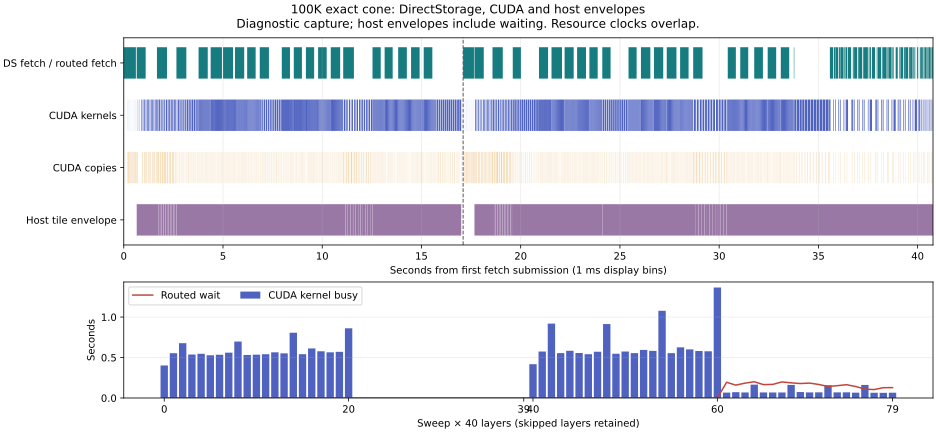

# Exact-cone performance evidence

The measured improvement is removal of a repeated graph-allocation plan. The 100K prompt still takes about 40 s. Near-zero weight wait, the owner's approximately 25 s two-sweep target and 12.6 s single-sweep target have **not** been achieved. A 100K single weight pass fits and is exact in the tested geometry, but has not beaten the two-pass default. The largest qualified single pass is 105824 tokens under the stated 11.8 GiB native/12.05 GiB outer caps; the hardware-absolute maximum is not established. The v6 tail hint passed exact comparisons but has not shown a reproducible speed gain and remains default 0.

Except for the explicitly labeled 105824-token boundary test, comparisons use 100,000 tokens, exact cone keep 2541 and matched numerical controls. Materialize r1/r2 and geometry r1 used light host timestamps without TILE_TIMING=1. Geometry r3/r4, v6 tail and boundary tests used TILE_TIMING=1 CUDA events plus host-thread counters in both arms; they are not uninstrumented measurements. Nsight is separate. [Metrics](performance/metrics.json) preserve full precision, binary SHA256 hashes, reported source revisions and validation results. Each pair matched frontier owners/state, all 16 forced full-vocabulary logit vectors, first token, recall token sequence and recall checkpoint. Reported source revision identifies the source base; these qualified manual native builds also include the tested changes. It is not a claim that a complete CUDA/CMake rebuild was performed. Native implementation is committed in ee868e3a; [source reconciliation](performance/native-source-notes.json) records a later CPU-counter comment clarification as the only difference from the frozen v6 build snapshot, with executable code unchanged across all 192 checked files.

| Experiment | Prompt control -> candidate (s) | TTFT control -> candidate (s) | Host prepare control -> candidate (s) |
|---|---:|---:|---:|
| Materialize r1, control first |40.540 -> 39.819|45.344 -> 43.406|4.467 -> 3.361|
| Materialize r2, candidate first |40.352 -> 39.796|43.860 -> 43.313|4.378 -> 3.430|
| Geometry r1, two passes -> one pass |40.096 -> 40.132|45.171 -> 45.485|3.511 -> 3.541|
| Geometry r3, candidate first |40.386 -> 41.331|44.063 -> 46.203|3.447 -> 3.437|
| Geometry r4, candidate first |40.009 -> 40.214|43.735 -> 45.203|3.425 -> 3.474|

The [allocator](../../../../engines/streaming-llama/prefill_llama.cpp/ggml/src/ggml-alloc.c) previously planned tensor lifetimes for size admission and then planned them again when allocating the buffers. The executor now materializes that already admitted plan once. The new API accepts one successful size-only plan and invalidates it on consumption or allocator mutation. Allocation and actual-size admission checks remain. Prompt savings reproduced in both run orders: 0.721 s and 0.556 s; prepare savings were 1.106 s and 0.949 s. These are two measured pairs, not a broad statistical estimate. The exact faster path is now the default; value 0 retains the second-reserve control.

Geometry r1 changed the two prompt folds `[49152,50848]` to one `[100000]` pass with two carry chunks. It cut actual fetched weights from 402.084 GB to 235.702 GB, but prompt time increased 0.035 s and TTFT increased 0.314 s. Host planning grew from 6.889 GB to 12.058 GB; device capacity was unchanged. Fewer bytes alone did not make it faster, so this does not justify promotion of the single-pass geometry. Geometry r3 repeated this under a 12.35 GiB native host cap/12.6 GiB outer RSS cap, and r4 used leaner 12/12.25 GiB caps. Both matched all five exact checks but the one-pass candidates were slower by 0.944 s and 0.205 s. N=1 remains the default; N=2 carry chunks are opt-in and admit one weight pass.

The largest qualified one-pass test, largest-safe-r1, processed 105824 tokens under an 11.8 GiB native/12.05 GiB outer cap. Control prompt/TTFT was 40.914/44.609 s; one-pass was 40.062/45.782 s. All five exact checks passed, including 16 full-vocabulary vectors with SHA256 `2fdddada36ee467c192ccc8d8c344d6eb488273656bb3019b7e60b9d2fc4a0e7`. The one-pass prompt improved, but TTFT increased; this does not override the 100K default decision. Outer guard peak RSS/minimum available RAM were 11410141184/3883589632 bytes for candidate and 6858448896/8690966528 for control; cleanup was confirmed. Global pagefile growth and incrementally observed owned paging were zero in both, with bounded observation rather than exhaustive attribution. At 105825 tokens, preflight requests 12673089536 host bytes against a 12670140416-byte ceiling and refuses before engine start.

The earlier 107840-token largest-r1 run produced **no qualified result**: the global paging-pressure guard stopped it after 988192768 bytes of global pagefile growth, with minimum available RAM 3364130816 bytes and cleanup confirmed. Incremental owned observation found zero paged bytes, but was not exhaustive and does not attribute the global growth to this job. Neither a fit nor a hardware-absolute maximum can be claimed from that failed run.

The provider already uses two admitted weight banks: compute reads the current bank while DirectStorage fills the following bank. A bank can be overwritten only after its compute lease is released. The DS queue permits one transfer submission in flight. These two slots cannot also retain arbitrary deeper full-layer prefetches. In routed-tail mode, the ordinary stage fetch omits routed expert matrices. Exact IDs become available only after the current layer's router; missing expert extents are then fetched synchronously. That wait occurs **inside executor compute wall**, so a small layer-acquire counter does not mean all weight wait disappeared.

An early routed-versus-full-buffer pair moved prompt 51.676 -> 44.540 s, but was confounded by a cold first-tile/kernel warm-up. Routed demand wait was 3.026 s; full buffering removed that counter while layer acquire grew 0.021 -> 6.748 s and bytes grew 402.084 -> 482.208 GB. It exchanges routed waits for full-stage waits and extra bytes. This pair is not evidence to enable full buffering by default.

The Nsight r3 diagnostic used CUDA tracing and tile events, with CPU sampling and context-switch collection disabled. Its graph admission ceiling was reduced by 128 MiB to accommodate instrumentation; the native 1 GiB GPU reserve, graph shapes, arithmetic, carry and job bound remained unchanged, and runtime graph admission still applied. It passed with prompt 40.707 s and TTFT 44.703 s, but is separate from the uninstrumented speed comparisons. Nsight warned that driver 13.3 was traced using its 13.2 libraries; no NVTX events were collected.

| Diagnostic window | First fold | Final fold |
|---|---:|---:|
| Window (s) |17.001|23.676|
| Fetched weights (GB) |166.383|235.702|
| DS fetch-envelope busy (s; utilization) |9.744;57.31%|13.229;55.88%|
| CUDA kernel interval union (s; utilization) |12.508;73.58%|15.783;66.66%|
| Layer acquire wait/binding (s) |0.0023|0.0093|
| Synchronous routed demand wait (s) |0|3.059|
| Host prepare wall (s) |1.640|1.868|

The first fold executes layers 0-20. The final fold also executes tail layers 21-39, with 5792 actual padded rows per layer from local start 45056, in tiles 4096+1696. Keep 2541 describes the semantic exact cone; tile granularity expands the executed row count. Its tail accounts for all 3.059 s routed wait, about 1.671 s kernel busy and 5.196 s layer wall. Those clocks overlap and must not be added. Cold layer0 acquisition is tiny in this capture. The historical approximately 8 s wait is therefore not reproduced as an acquisition counter on these defaults; the remaining measured demand wait is concentrated in the cheap final tail.

Across the two windows, DS envelopes occupy 22.973 of40.676 s;94 idle intervals total 17.703 s. CUDA kernels occupy 28.291 s. Fetch envelopes include submission/fence/verification overhead and are not physical SSD activity samples; kernel intervals do not measure SM occupancy. Host tile envelopes include waiting, and the blank `host_thread_cpu_ms` column means actual CPU busy time was not collected. These observations show GPU work and host/release gaps as additional limits; they do not establish a CPU-busy attribution. Across the full captured process trace, the largest kernel-duration sums were 9.054 s for MoE `mul_mat_q_id`, 4.684 s for token-tile HMMA attention and 1.784 s for Q8 `mul_mat_q`. These are per-kernel duration sums, not interval unions or occupancy measurements; the capture includes activity outside the published prefill windows. At the assumed25GB/s, the measured402.084 GB implies a16.083 s byte-only floor; this is an idealized bound, not achieved bandwidth. The one-pass 235.702 GB bound would be9.428 s. The owner's earlier316GB-per-sweep arithmetic is not today's measured byte count.

Later v6 measurements add actual calling-thread CPU counters from the reverse tail-r2 pair:

| Arm | First fold CPU (s) | Final fold CPU (s) | Total CPU (s) | Host tile envelope (s) |
|---|---:|---:|---:|---:|
| Control |15.266|18.922|34.188|38.423|
| Hint candidate |15.297|18.766|34.063|38.405|

These native GetThreadTimes counters measure user+kernel CPU time on the executor calling thread. They exclude blocked/descheduled waiting and provider/other workers, but can include active CUDA/driver polling during synchronization. They are not graph-preparation time, total-process CPU busy or a scheduler timeline. CPU and GPU clocks overlap. The [experiment/arm summary](performance/host-cpu-summary.json), [control histogram](performance/tail-r2-control-histogram.csv), [candidate histogram](performance/tail-r2-candidate-histogram.csv), and corresponding [control](performance/tail-r2-control-idle_intervals.csv)/[candidate](performance/tail-r2-candidate-idle_intervals.csv) stream-idle CSVs preserve the evidence. Their times are relative to each arm's first fetch.

The opt-in [tail hint](../../../../engines/streaming-llama/prefill_llama.cpp/src/llama-dsv41-tail-hint.h) predicts at most 24 experts for one already-ready next bank. It adds 8 MiB host admission and no weight bank. The worker verifies CPU storage completion without inserting a wait into current compute; the next acquire checks stage/bank/generation, inserts the consumer CUDA fence and adopts its bitmap. Demand routing still fetches every actual miss. Release, restart, failure and destruction join the worker. Model-free lifecycle/generation tests and native syntax checks pass. Wrong predictions can add bytes, serialize later demand on the shared queue, expose a release join, or lose to thread/request overhead. It remains default 0. Hint join metrics are keyed by target stage but accumulate both the preceding release and target acquire; they are not wholly target-layer wall time.

| Tail-hint trial | Prompt control -> candidate (s) | TTFT control -> candidate (s) | Demand wait control -> candidate (ms) |
|---|---:|---:|---:|
| r1, control first |41.1425 -> 40.0708|46.093 -> 43.718|3139.656 -> 2989.423|
| r2, candidate first |39.9117 -> 39.9131|43.468 -> 43.453|2939.617 -> 2907.012|

Both trials matched all five exact comparison checks. The first trial's acquisition counter also changed 536 -> 35 ms, so its large time difference is noisy; the reversed trial showed no prompt gain. In each pair, total bytes increased 402.084 -> 405.568 GB. The first candidate hinted 6.290 GB with only 0.1099 ms cumulative join wait. Hiding those hints does not hide every remaining demand read, and the extra bytes have a cost. The hint remains default 0; no speed promotion is justified. The full CPU suite ran 607 tests: 595 passed, 12 skipped, zero failures.

The [40-layer x 2-fold histogram](performance/histogram.csv), [idle intervals](performance/idle_intervals.csv) and [event envelopes](performance/events.csv) retain skipped layers and precise durations. Event and idle positions share one relative origin at first fetch submission; absolute machine clocks were removed. The SVG uses the same relative axis and 1 ms display bins, while CSVs preserve interval data. Windows exclude model open, bulk export, final head compute and inter-pass admission; use the separate prompt/TTFT table for end-to-end timing. [Source SHA256 hashes and sanitization rules](performance/sources.json) bind the private source receipts to these compact exports; [native source hashes](performance/native-source-hashes.json) record the current manual-build source and link artifacts, including changes beyond its registration base; [published-file digests](performance/artifacts.json) bind the reviewable artifacts. Raw profiler databases, reports, private configurations and PNGs are not published.
